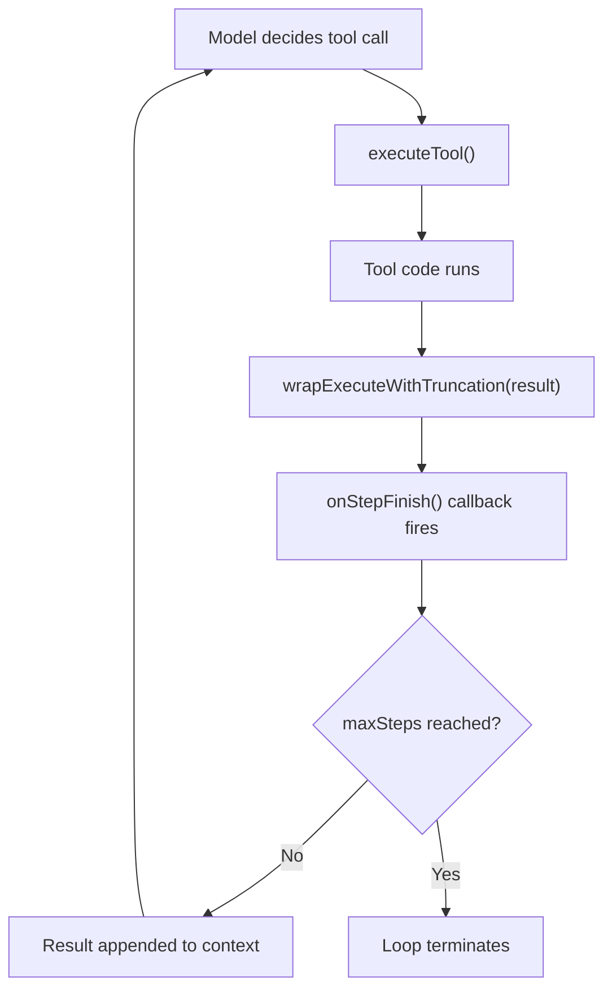

We built NeuroLink's agentic loop controls after watching a prototype get stuck. The agent, designed to triage bug reports, entered a loop trying to fetch a Jira ticket that did not exist. It called the same tool with the same arguments, over and over, burning through our Anthropic token budget with every useless attempt. This wasn't a theoretical edge case; it was a real, cascading failure that highlighted a fundamental gap in early agent frameworks. An autonomous system without guardrails isn't autonomous; it's a liability. That incident led directly to the safeguards we use in every agent today: hard step limits, per-step observability hooks, and explicit escape conditions.

## The Runaway Loop Problem

An agentic loop is simple: the model thinks, decides to use a tool, executes it, observes the result, and repeats. The danger is that the model's reasoning can get stuck. It might decide the same tool is needed again, even if the tool's output indicates no progress was made. A tool returning `null` or an empty array is a common trigger; the model, lacking a clear success signal, simply retries the last command. Its conversational memory becomes polluted with identical, useless exchanges, making it progressively harder for it to reason its way out of the loop.

Without any controls, this can go on indefinitely. We saw this with tools that required very specific ID formats; if the model generated a plausible but incorrect ID, the tool would fail, and the model would stubbornly try again with the same invalid ID.

```typescript
// A tool prone to causing loops if the model gets confused.
const findUserById = createTypedTool({
  name: 'findUserById',
  description: 'Find a user by their unique database ID.',
  input: z.object({ userId: z.string().uuid() }),
  execute: async ({ userId }) => {
    // This might return null if the user doesn't exist.
    const user = await db.users.findUnique({ where: { id: userId } });
    if (!user) {
      return { error: 'User not found.' };
    }
    return user;
  },
});
```

This `generate` call is a blank check. If the model finds a reason to loop, it will. The cost is measured in tokens and API latency, but the real damage is to system reliability. A single runaway agent can consume resources, pollute logs, and prevent other critical tasks from executing.

```typescript
import { neurolink } from './neurolink'; // Assuming an initialized NeuroLink instance

async function runUnsafeAgent(prompt: string) {
  const result = await neurolink.generate({
    model: 'claude-3-opus-20240229',
    prompt: prompt,
    tools: [
      /* ... a set of tools ... */
    ],
  });

  return result;
}
```

## First Line of Defense: `maxSteps`

The simplest and most effective guardrail is a hard stop. We exposed this as `maxSteps` in the generation options. We learned that every agent needs a budget, not just for tokens, but for execution steps. Internally, our `performMCPGenerationRetries` logic uses this limit as its primary escape hatch.

NeuroLink ships with a conservative default. The internal `DEFAULT_MAX_STEPS` is set to 200, and the absolute ceiling is governed by `STEP_LIMITS.max` at 500 steps. For most interactive tasks, even 10 steps is a generous budget. When this limit is reached, the generation process is terminated, and the final result will indicate that the loop was halted due to exceeding the step count. This check is performed by our internal `ensureMCPGenerationBudget` function before each potential tool-using turn.

Here is how you set a custom limit:

```typescript
async function runSaferAgent(prompt: string) {
  const result = await neurolink.generate({
    model: 'claude-3-opus-20240229',
    prompt: prompt,
    tools: [
      /* ... */
    ],
    maxSteps: 15, // Stop after 15 tool-use cycles
  });

  return result;
}
```

Setting `maxSteps` turns an infinite loop into a finite, bounded process. It's the circuit breaker pattern, applied to agentic reasoning. Choosing the right number depends on the task, but starting low is always the safest option. You can always raise the limit if a complex task genuinely requires more steps.

## Observing the Loop: The `onStepFinish` Callback

Stopping a runaway loop is only half the battle. You also need to understand *why* it was looping. Was the prompt ambiguous? Was a tool returning an error the model couldn't interpret? This is where observability comes in.

We added the `onStepFinish` lifecycle hook to give developers a window into the agent's turn-by-turn execution. This callback fires after each tool call completes, providing the tool's output and the current state of the loop. The `step` object passed to this callback contains the zero-based `index`, the `toolCall` details, and the `toolResult`. Crucially, the `toolResult` seen by this hook is the raw, untruncated output from the tool, which is invaluable for debugging cases where a large result is being capped. Our internal metrics listeners, like `handleToolEndMetrics`, also use this hook to record performance and trace data.

```typescript
async function runObservedAgent(prompt:string) {
  const result = await neurolink.generate({
    model: 'claude-3-opus-20240229',
    prompt: prompt,
    tools: [
      /* ... */
    ],
    maxSteps: 15,
    onStepFinish: (step) => {
      console.log(`Step ${step.index} finished.`);
      console.log(`Tool call:`, step.toolCall);
      // The 'step.toolResult' here is the full, untruncated output.
      console.log(`Tool output:`, step.toolResult);
    },
  });

  return result;
}
```

With this hook, you can log each step to your observability platform, check for repetitive tool calls, or even intervene programmatically if the agent appears to be stuck. It's an essential tool for debugging and for building the kind of high-stakes, reliable systems our internal teams at Juspay depend on. The ability to see each step is also critical for the entire evaluation process, which we cover in [Grading the model: the scorer hierarchy and evaluation pipeline](/posts/grading-the-model-the-scorer-hierarchy-and-evaluation-pipeline/).

## The Tool's Responsibility: Output Truncation

Another failure mode we encountered was a tool returning an enormous result. A single call to a file-reading tool could dump megabytes of text into the context, blowing the budget for that turn and often for the entire session.

To prevent this, our internal tool manager automatically wraps tool execution in a process that caps the size of the result. The `wrapExecuteWithTruncation` function enforces a hard limit of 51,200 bytes on any tool's output before it's passed back to the model. This is implemented by the `truncateToolResult` utility, which performs a simple byte-level slice and appends a clear notice. This ensures that no single tool can unilaterally derail the agent. The model sees a note like `[...Output truncated...]`, allowing it to adapt its strategy, perhaps by using more specific parameters on the next tool call.

```typescript
// A tool that might return a very large string.
const readFileTool = createTypedTool({
  name: 'readFile',
  description: 'Reads the entire content of a file.',
  input: z.object({ path: z.string() }),
  execute: async ({ path }) => {
    // This could be megabytes of text.
    const content = fs.readFileSync(path, 'utf-8');
    return { content };
  },
});
// When this tool is used, wrapExecuteWithTruncation ensures the
// returned 'content' is capped before being sent to the model.
```

This flow illustrates the lifecycle of a single, safeguarded step.



## Explicit Termination: The `finish` Tool

While `maxSteps` is a crucial backstop, a well-behaved agent should know when its work is complete. It shouldn't have to be forced to stop; it should be able to terminate the loop itself.

The standard pattern for this is a dedicated `finish` tool. You provide a simple tool that does nothing except signal that the task is done. When the model determines it has the final answer, it calls this tool. The agent loop machinery inspects the result of every tool execution for a sentinel value (like `finished: true`) that indicates the loop should be gracefully concluded.

We use `createTypedTool` to define a strongly-typed tool with a Zod schema for its arguments. For a finish tool, the arguments can be a final answer or summary. The Zod schema is not just for documentation; it's used at runtime to parse and validate the LLM's generated JSON arguments, preventing a whole class of injection and formatting errors.

```typescript
import { z } from 'zod';
import { createTypedTool } from './tools'; // Simplified import

const finishTool = createTypedTool({
  name: 'finish',
  description: 'Call this when you have the final answer and all work is complete.',
  input: z.object({
    answer: z.string().describe('The final, complete answer to the user query.'),
  }),
  execute: async ({ answer }) => {
    // The 'generate' loop checks for this 'finished' property.
    return {
      finalAnswer: answer,
      finished: true, // A sentinel value
    };
  },
});
```

When the `generate` loop sees a tool result containing a special key or value, it can halt execution gracefully. This is far more elegant than hitting a step limit and provides a clear success signal. This explicit tool-based control is a core concept, and it's important that it's handled consistently, which is part of [why every native provider must wire the same tool-persistence hook](/posts/why-every-native-provider-must-wire-the-same-tool-persistence-hook/). Many of our standard toolkits, like `directAgentTools`, include a pre-built `finish` tool so you don't have to create it yourself.

## Assembling a Safe Toolbelt

Finally, reliability comes from curation. An agent with too many tools, or the wrong tools, is more likely to fail. We encourage developers to provide only the tools necessary for the job at hand. Giving an agent a full `bashTool` is powerful, but extremely dangerous if the task only requires reading a single file.

The `getToolsForCategory` utility provides a simple way to select from pre-defined bundles of trusted tools. Instead of giving an agent access to the entire filesystem and a shell, you can grant it a safer subset. The 'basic' category might include a calculator and our `finish` tool, while the 'filesystem' category is carefully constrained by sandboxing rules configured via `resolveFileToolRoots`.

```typescript
import { getToolsForCategory } from './toolsets'; // Simplified import

// Get a curated set of safe, basic tools.
const safeTools = getToolsForCategory('basic');

// For more advanced use cases, you might add filesystem tools.
const fileAgentTools = [
  ...getToolsForCategory('basic'),
  ...getToolsForCategory('filesystem'),
];

// Granting dangerous tools should be a very deliberate choice.
const powerAgentTools = [
  ...fileAgentTools,
  ...getToolsForCategory('dangerous'), // Contains tools like `bashTool`
];
```

This approach, combined with `maxSteps` and a `finish` tool, forms the foundation of a reliable agentic loop. It's a move away from the "give the model a shell and hope" approach to a more structured, observable, and deterministic architecture. This level of control is essential for moving agents from interesting demos to production-ready components of a larger system, where different inference types like `generate`, `stream`, and [`decide`](/posts/generate-stream-decide-a-third-inference-type-for-neurolink/) all need to operate with predictable behavior.

---

**Related posts:**

- [Two decision providers, one decide(): what Laya forced on NeuroLink](/posts/two-decision-providers-one-decide-what-laya-forced-on-neurolink/)
- [Why Every Native Provider Must Wire the Same Tool-Persistence Hook](/posts/why-every-native-provider-must-wire-the-same-tool-persistence-hook/)
- [generate, stream, decide: a third inference type for NeuroLink](/posts/generate-stream-decide-a-third-inference-type-for-neurolink/)
- [Grading the model: the scorer hierarchy and evaluation pipeline](/posts/grading-the-model-the-scorer-hierarchy-and-evaluation-pipeline/)
