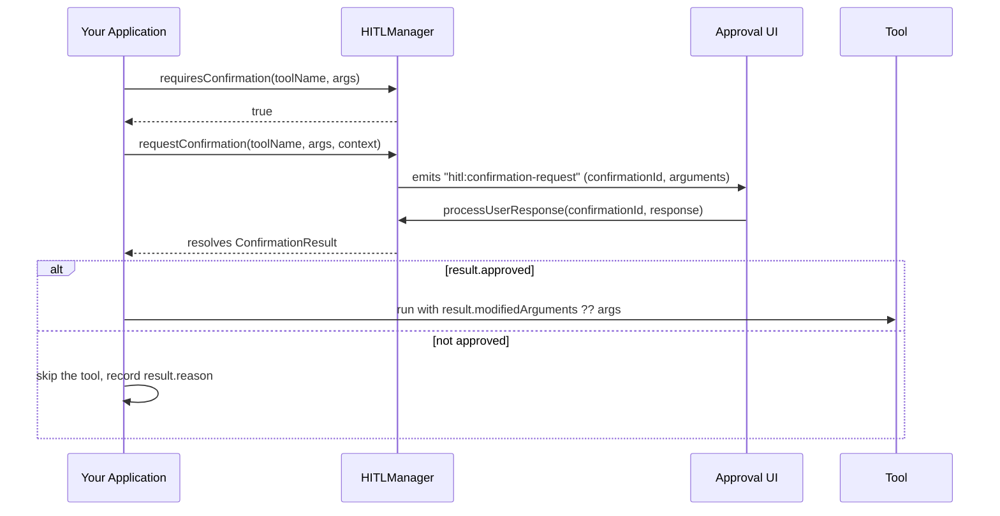

In NeuroLink, the `dangerousActions` list in a `HITLConfig` is a keyword match on the tool name: `HITLManager` lowercases the name and asks for confirmation if it contains any keyword. That is a good default, but it cannot look at arguments. A tool called updateConfigFile is harmless when it writes to a scratch directory and risky when it writes to /etc/, and a keyword list treats both calls the same. You either confirm every call and train reviewers to click "approve" without reading, or confirm none.

`HITLManager` adds four pieces a production deployment needs beyond that list: argument-aware rules, a way for the reviewer to correct a call before it runs, an audit event stream, and live statistics. This tutorial walks through each one, using only the methods and fields the class exposes.

## Beyond Keywords: A Custom Rule Engine

The `customRules` property in your `HITLConfig` takes an array of `HITLRule` objects. Each rule has a `name`, a `condition(toolName, args)` predicate, a `requiresConfirmation` flag, and an optional `customMessage`. When you call `requiresConfirmation(toolName, args)`, the manager first checks the `dangerousActions` keywords, then runs the `condition` of every rule whose `requiresConfirmation` is `true`. The first condition that returns `true` makes the call need confirmation.

Two details matter when you design rules. First, a rule with `requiresConfirmation: false` is skipped entirely: it cannot exempt a call that a keyword or another rule has flagged. Express exemptions inside the condition of the rule that flags the call. Second, if a condition throws, the manager records a `rule-evaluation-error` and moves on to the next rule, so a buggy predicate fails open for that rule. Keep conditions small and defensive.

Here is a rule that asks for confirmation only when updateConfigFile targets a protected directory.

```typescript
import { HITLManager } from '@juspay/neurolink/hitl';
import type { HITLConfig } from '@juspay/neurolink';

const config: HITLConfig = {
  enabled: true,
  dangerousActions: [], // rely on the rule below instead of keywords
  customRules: [
    {
      name: 'protected-config-paths',
      condition: (toolName, args) => {
        if (toolName !== 'updateConfigFile') return false;
        const path = (args as { path?: unknown })?.path;
        return typeof path === 'string' && (path.startsWith('/etc/') || path.startsWith('/root/'));
      },
      requiresConfirmation: true,
      customMessage: 'This call edits a protected configuration file.',
    },
  ],
};

const hitlManager = new HITLManager(config);

// No confirmation: the path is outside the protected directories.
console.log(hitlManager.requiresConfirmation('updateConfigFile', { path: '/tmp/app.conf' })); // false

// Confirmation required: the rule's condition matches.
console.log(hitlManager.requiresConfirmation('updateConfigFile', { path: '/etc/app.conf' })); // true

export {};
```

It prints:

```text
false
true
```

Because the condition receives the arguments as `unknown`, narrow them before you read a field. That keeps the rule safe when a model sends a malformed payload: the property read returns `undefined` and the rule returns `false` instead of throwing.

## The Confirmation Workflow

`requiresConfirmation` only answers the question. Your application decides what to do with the answer, and asks for a decision with `requestConfirmation(toolName, args, context?)`. The manager generates the confirmation ID itself, emits a `hitl:confirmation-request` event that carries it, and returns a promise. Your approval UI listens for that event and answers with `processUserResponse(confirmationId, response)`.



In normal use the promise settles in one of three ways. It resolves with a `ConfirmationResult` when the reviewer answers, whether they approve or reject: a rejection is `{ approved: false, reason }`, not an exception. It rejects with `HITLTimeoutError` when nobody answers in time (unless timeout auto-approval is on), and with `HITLCancelledError` when the request is withdrawn. Apart from those, `cleanup()` rejects every request still pending with a plain `Error`. This shape is the same idea behind [migrating a generate()-based judgment call to decide()](/posts/migrating-a-generate-based-judgment-call-to-decide/): the decision comes back as data you branch on.

## Argument Modification: The Human as a Sanitizer

Sometimes a model's call is almost right: the right tool, the wrong path. Rejecting it forces another round trip; a reviewer can often fix the argument in place. The response you pass to `processUserResponse` may include `modifiedArguments`, and the manager copies them into the `ConfirmationResult` it resolves. Your code then runs the tool with those arguments.

`allowArgumentModification` is how you tell the approval UI that editing is allowed: its value is sent to the UI as `allowModification` in the request event. The manager does not enforce it. A response's `modifiedArguments` reach your code whether the flag is on or off, so check it in your own code if editing must be forbidden.

```typescript
import { HITLManager } from '@juspay/neurolink/hitl';
import type { ConfirmationResult } from '@juspay/neurolink';

const hitlManager = new HITLManager({
  enabled: true,
  dangerousActions: ['updateconfig'],
  allowArgumentModification: true, // tells the UI it may offer an edit box
});

// Approval UI side: show the request, then answer it.
hitlManager.on('hitl:confirmation-request', (event) => {
  const { confirmationId, arguments: proposed } = event.payload;
  console.log('Review requested:', proposed);
  // The reviewer approves but corrects the target path.
  hitlManager.processUserResponse(confirmationId, {
    approved: true,
    modifiedArguments: { path: './production.conf', content: 'data' },
    userId: 'reviewer-42',
  });
});

// Application side: ask, then run with whatever the reviewer approved.
async function runToolWithConfirmation(toolName: string, args: unknown) {
  if (!hitlManager.requiresConfirmation(toolName, args)) {
    return run(toolName, args);
  }
  const result: ConfirmationResult = await hitlManager.requestConfirmation(toolName, args);
  if (!result.approved) {
    console.log(`Rejected: ${result.reason ?? 'no reason given'}`);
    return;
  }
  return run(toolName, result.modifiedArguments ?? args);
}

function run(toolName: string, args: unknown) {
  console.log('Executing', toolName, args);
}

runToolWithConfirmation('updateConfigFile', { path: './staging.conf', content: 'data' });

export {};
```

It prints the arguments the reviewer saw, then the call that ran:

```text
Review requested: { path: './staging.conf', content: 'data' }
Executing updateConfigFile { path: './production.conf', content: 'data' }
```

The reviewer becomes a final validation layer, and the corrected call is the one that runs.

## Production Observability: Statistics and Audit Events

When HITL runs in production you want to know how many requests are waiting and how long people take to answer. `getStatistics()` returns a copy of the manager's counters as a `HITLStatistics` object: `totalRequests`, `pendingRequests`, `approvedRequests`, `rejectedRequests`, `timedOutRequests`, and `averageResponseTime` in milliseconds. Because it returns a copy, you can read it from a metrics endpoint without touching the manager's state.

```typescript
import { HITLManager } from '@juspay/neurolink/hitl';

const hitlManager = new HITLManager({ enabled: true, dangerousActions: ['delete'] });

// Call this from a /metrics endpoint or a periodic job.
function printStats() {
  const stats = hitlManager.getStatistics();
  console.log('--- HITL Statistics ---');
  console.log(`Total requests: ${stats.totalRequests}`);
  console.log(`Pending now: ${stats.pendingRequests}`);
  console.log(`Approved: ${stats.approvedRequests}`);
  console.log(`Rejected: ${stats.rejectedRequests}`);
  console.log(`Timed out: ${stats.timedOutRequests}`);
  console.log(`Average response time: ${Math.round(stats.averageResponseTime)}ms`);
  console.log(`Pending (live count): ${hitlManager.getPendingCount()}`);
}

// A stand-in reviewer: approves the first request and rejects the second. It passes
// responseTime itself so the average below is the same on every run.
let answered = 0;
hitlManager.on('hitl:confirmation-request', (event) => {
  const { confirmationId, toolName } = event.payload;
  console.log(`Waiting on ${toolName}: ${hitlManager.getPendingCount()} pending`);
  answered += 1;
  if (answered === 1) {
    hitlManager.processUserResponse(confirmationId, { approved: true, userId: 'reviewer-42', responseTime: 1200 });
  } else {
    hitlManager.processUserResponse(confirmationId, { approved: false, reason: 'wrong customer', userId: 'reviewer-42', responseTime: 800 });
  }
});

await hitlManager.requestConfirmation('deleteOrder', { orderId: 'A-1001' });
await hitlManager.requestConfirmation('deleteOrder', { orderId: 'A-1002' });
printStats();

export {};
```

After one approval and one rejection, it prints:

```text
Waiting on deleteOrder: 1 pending
Waiting on deleteOrder: 1 pending
--- HITL Statistics ---
Total requests: 2
Pending now: 0
Approved: 1
Rejected: 1
Timed out: 0
Average response time: 1000ms
Pending (live count): 0
```

Counters tell you how the system behaves; an audit trail tells you who decided what. Set `auditLogging: true` and the manager writes an entry for each step of a confirmation's life (requested, approved, rejected, timed out, auto-approved, cancelled) and emits it as a `hitl:audit` event. Each entry is a `HITLAuditLog` with a timestamp, an `eventType`, the tool name, the arguments, a `userId`, and, where the step has them, the reason and the response time. On a `confirmation-requested` entry the `userId` is the requester's, taken from the request context; on a decision entry it is the reviewer's, taken from the response. Subscribe once and forward entries to the store your compliance team already uses.

```typescript
import { HITLManager } from '@juspay/neurolink/hitl';
import type { HITLAuditLog } from '@juspay/neurolink';

const hitlManager = new HITLManager({
  enabled: true,
  dangerousActions: ['delete'],
  auditLogging: true,
});

hitlManager.on('hitl:audit', (entry: HITLAuditLog) => {
  // Forward to your log pipeline; one line per audit event. Keep entry.timestamp in a
  // real pipeline; it is left out here so the saved output is the same on every run.
  console.log(JSON.stringify({
    event: entry.eventType,
    tool: entry.toolName,
    by: entry.userId,
    reason: entry.reason,
  }));
});

// A stand-in reviewer that answers a moment after the request is shown.
hitlManager.on('hitl:confirmation-request', (event) => {
  const { confirmationId } = event.payload;
  setTimeout(() => {
    hitlManager.processUserResponse(confirmationId, {
      approved: false,
      reason: 'needs a ticket number',
      userId: 'reviewer-42',
    });
  }, 10);
});

const result = await hitlManager.requestConfirmation('deleteUser', { userId: 'u-314' }, { userId: 'ops-bot' });
console.log(`approved: ${result.approved}`);

export {};
```

The rejected request leaves one entry for the request and one for the decision:

```text
{"event":"confirmation-requested","tool":"deleteUser","by":"ops-bot"}
{"event":"confirmation-rejected","tool":"deleteUser","by":"reviewer-42","reason":"needs a ticket number"}
approved: false
```

## Handling Timeouts and Errors

A confirmation cannot wait forever. `timeout` in the config sets how long the manager waits for an answer, 30,000 ms when you leave it out. When it expires, the manager counts a timeout and, by default, rejects the promise with `HITLTimeoutError`, which carries the `timeout` that applied. This is the fail-safe posture.

For low-risk tools you can fail open instead: `autoApproveOnTimeout: true` resolves a timed-out request as approved, and its reason says it was auto-approved. `autoApproveExclusions` lists exact tool names that still need an explicit answer, so one flag does not quietly approve your most dangerous tool.

Two error classes can reject a `requestConfirmation` promise, and both come from the @juspay/neurolink/hitl entry point. `cleanup()` can also reject one, with a plain `Error`, which is why the example below rethrows anything else. A third class, `HITLConfigurationError`, is thrown by the constructor (and by `updateConfig`) when a config with `enabled: true` is invalid, for example a `timeout` of zero. A config with `enabled: false` is not validated.

- `HITLTimeoutError`: nobody answered before the timeout and auto-approval did not apply.
- `HITLCancelledError`: the request was withdrawn, through `cancelConfirmation(confirmationId, reason)` or an aborted `signal` in the context. It carries the `reason`.
- `HITLConfigurationError`: the manager was given an invalid config with `enabled: true`.

A rejection by the reviewer is not on this list: it resolves with `approved: false`.

```typescript
import { HITLManager, HITLTimeoutError, HITLCancelledError } from '@juspay/neurolink/hitl';

const hitlManager = new HITLManager({
  enabled: true,
  dangerousActions: ['deletedatabase'],
  timeout: 60_000, // one minute
});

async function runCriticalTask(signal: AbortSignal) {
  try {
    const result = await hitlManager.requestConfirmation(
      'deleteDatabase',
      { dbName: 'customers' },
      { userId: 'ops-bot', signal },
    );
    if (!result.approved) {
      console.log(`Reviewer rejected the action: ${result.reason ?? 'no reason given'}`);
      return;
    }
    // ... proceed on approval
  } catch (error) {
    if (error instanceof HITLTimeoutError) {
      console.error(`No answer within ${error.timeout}ms. Paging on-call.`);
    } else if (error instanceof HITLCancelledError) {
      console.warn(`Confirmation was withdrawn: ${error.reason ?? 'no reason given'}`);
    } else {
      throw error;
    }
  }
}

export {};
```

Choosing between fail-safe and fail-open per tool is the same kind of decision you make for different backends in [runtime provider switching](/posts/provider-switching-at-runtime-providerfallback-callbacks-and-modelchain-arrays/): the safe default stays on, and you relax it only where you have decided the risk is acceptable.

---

**Related posts:**

- [We ran our decision-model audit again, and recorded every request](/posts/we-ran-our-decision-model-audit-again-and-recorded-every-request/)
- [Migrating a generate()-based judgment call to decide()](/posts/migrating-a-generate-based-judgment-call-to-decide/)
